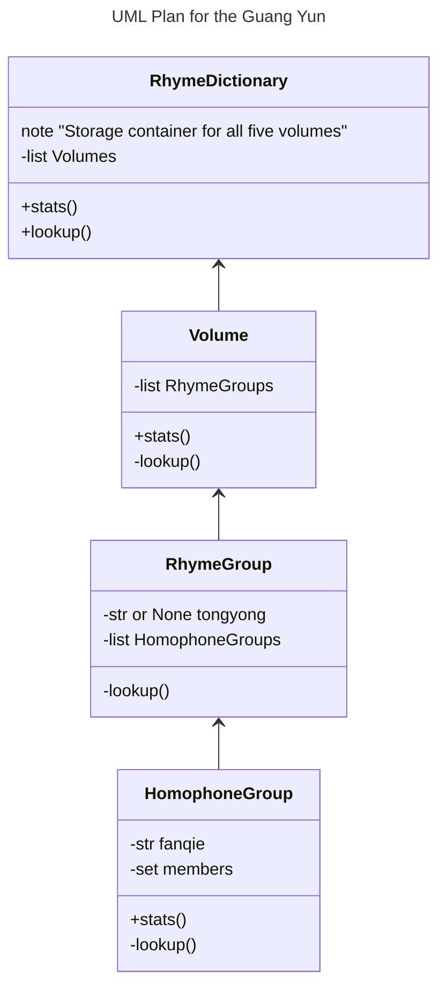

# Design

## Motivation

I began this project years ago. Now I'm a better Python developer. It's time to
gut the repo and build back better.

A Python `dict` is easily robust enough to store a rhyme dictionary; however,
since the API requires non-trivial search functionality, we'll use real OOP and
build out a class with appropriate methods.

## Class Design

## UI

### CLI based, at least for starters

* Optional arguments
  * `-v` control verbosity of logging
  * `-zh` Chinese output

### Future

Potentially add interactive command interface with cmd.Cmd... or even a GUI.
